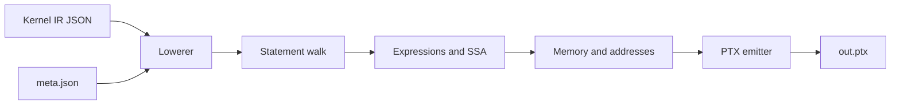

# Emmy Kernel IR to PTX

A direct PTX backend for [Emmy](https://github.com/cloudrift-ai/emmy)'s Kernel IR, written for
the RiftStack Emmy Hackathon 2026. Python in, PTX out. The compiler invokes no CUDA C++
compiler, no `nvcc`, and no Emmy renderer; the task's runner assembles the emitted PTX with
`ptxas` downstream.

```bash
python3.12 -m venv .venv
. .venv/bin/activate
pip install -r requirements.txt
python compile.py tests/variants/v_p_div/k_div_pointwise.ir.json > out.ptx
head -5 out.ptx
```

`compile.py` at the repository root takes one IR path and writes PTX to stdout. The sibling
`meta.json` supplies the launch geometry, parameter order and shared-memory budget. That is the
whole contract.

**Verified 2026-10-28.** 15/15 open problems, 46/46 checked-in variants, 86/86 generated corpus
IRs, 147/147 local IRs, and 15/15 on the hosted RTX 5090 runner twice. The verified release and
the exact commands are in [docs/VERIFICATION.md](docs/VERIFICATION.md).

## What it does

- Lowers the Emmy Kernel IR statement tree directly to PTX: `Tile`, `Loop`, `StridedLoop`,
  `Load`, `Write`, `Accum`, `Let`, `Assign`, `Cond`, `Sync`, `Smem`, `WarpShuffle`,
  `TreeHalve`, `CpAsyncCopy`, `ZeroPrologue` and the documented expression nodes.
- Supports `f16`, `f32` and `f64` buffers plus integer scalar arguments, and the pointwise,
  reduction, matmul, fused and attention-like categories. See
  [docs/COVERAGE.md](docs/COVERAGE.md) for the construct-by-construct matrix and the known gaps.
- Emits guarded exact launches, 32-bit index arithmetic, staged `cp.async` tiles, shared-memory
  caches, warp reductions, block reductions, atomics, split-K, BMM, 4D softmax and two-kernel
  chains.
- Fails loudly with `CompileError` on missing or invalid launch fields, unknown dtypes, ops,
  statements, and malformed IR. The launch contract is `meta.json`; a well-formed problem always
  supplies it.

## What is new

This is an engineering composition, not a new compiler algorithm. The contribution is the
artifact and the evidence, and the prior art is named in [DESIGN.md](DESIGN.md#related-work).

- A direct Kernel IR to PTX backend in Python, with no CUDA C++ intermediate. `ptxas` assembles
  the emitted PTX downstream, as the task requires.
- A guarded composition of seven standard mechanisms: single-trip copy loops, bounded copy
  unroll, four-wide shared loads with alignment, affine address CSE gated by tile count, lane
  folding gated by fan-out, divmod recombination and all-shared loop unroll. The guard analysis
  is the part re-derived for this IR.
- Coverage of five kernel families, three exercised buffer dtypes (f16, f32, f64), tensor ranks 1 to 4, split-K, BMM, `cp.async`, shared
  caches, warp and tree reductions, atomics and 16 attention shapes, with 92 tests and 88
  benchmark cells.
- An interleaved 88-cell evaluation: 43 shapes in the main session plus labeled S2/S3 rechecks,
  with medians, sample counts and the slowest cell disclosed.
- A measured phase-ordering instance: the affine address cache improves large matmuls but
  regresses a 256-tile attention shape; the lane fold helps split-K but regresses the 2048
  matmul. A static tile-count and fan-out gate removes the measured regressions. We report this as an empirical characterization and a
  guardrail, not a new optimization or a general law.

## Features at a glance

| area | support | evidence |
|---|---|---|
| Launches | 1D launch exercised; 2D/3D lowering implemented; exact and over-provisioned | open set, `stress`, `blocks`, unit tests |
| Pointwise | 1D to 3D tiles, unrolled bodies, vector loads and stores, `where`, `pow`, `relu`, transcendentals | open set, `fuzz`, `ops`, `fixed` |
| Reductions | 1D and 2D sums, means, row max, warp shuffle, shared tree, coupled states, atomics | open set, `stress`, `blocks`, `dtypeedge` |
| Matmul | static and dynamic shared tiles, `cp.async`, split-K, odd K, matvec, BMM, batch, epilogues | open set, `stress`, `fuzz`, `adv` |
| Fused | rmsnorm, layernorm, affine layernorm, 2D and 4D softmax, l2norm | open set, `ln`, `adv`, `fuzz` |
| Attention | cached key tile or slice, warp dot, heads 16 to 256, sequences 16 to 512 | open set, 16 generated shapes |
| Dtypes | `f16`, `f32`, `f64` exercised; integer scalar handling | `f16`, `dtypeedge`, `ops`, `adv`, machinery tests |
| Errors | unknown dtype, op, statement, malformed meta values and IR raise `CompileError` | machinery tests |
| External tools | none in the compile path; `emmy` supplies the IR types and `Graph.from_dict` | `python tests/test_no_external.py` |

Representative runnable examples, all self-contained under `tests/variants`:

```bash
# pointwise division
python compile.py tests/variants/v_p_div/k_div_pointwise.ir.json > /tmp/p.ptx
# rectangular matmul
python compile.py tests/variants/v_m_rect_small/k_matmul.ir.json > /tmp/m.ptx
# rmsnorm
python compile.py tests/variants/v_f_rms_512/k_mean_50e2d6.ir.json > /tmp/f.ptx
# attention with a 32x256 query tile
python compile.py tests/variants/v_a_32x256/k_matmul_softmax_reduce_20729c.ir.json > /tmp/a.ptx
```

For the 15 open problems, put the task repository next to this one and run
`TASK=../task tools/testall.sh`; the runner address is supplied through `RUNNER_URL`. See
`examples/README.md` for the feature tour.

## How it works

The compiler is one walk over the statement tree. The prologue reads the launch contract,
materializes the shared bases, and emits the thread helpers. The Tile decode turns the flattened
work id into axes. The walk lowers statements and expressions, and the emitter owns virtual
registers, labels and PTX text.



| module | responsibility |
|---|---|
| `compile.py` | the task CLI, IR loading and meta lookup |
| `ptxc/lower.py` | prologue, Tile decode, cache selection, module assembly |
| `ptxc/stmts.py` | statement control flow, loops, copies, reductions, barriers |
| `ptxc/expr.py` | expressions, SSA values, predicates, dtype casts |
| `ptxc/memory.py` | flat indices, shared layout, addresses, alignment proofs |
| `ptxc/emitter.py` | virtual registers, labels, literal block, PTX text |
| `ptxc/common.py`, `ptxc/ops.py` | shared tables and IR utilities |

Three invariants drive the design. The launch is the contract, so `meta.json` decides the
geometry and an exact launch skips the work guard. Accumulators are loop-carried, so a fold
writes back into the same register and each loop instance owns its seed. State used under a
predicate is defined unconditionally, so the lane/warp helpers and shared bases live in the prologue.
See [DESIGN.md](DESIGN.md) for the full architecture and [docs/CODEMAP.md](docs/CODEMAP.md) for
a function-level map.

## Results

Warm and cold medians on the hosted RTX 5090 runner, interleaved; S1 rows are same-session and S2/S3 are labeled rechecks. Warm is 10
warmup launches plus 100 iterations and cold is one launch. The full 88-cell absolute matrix,
sample counts and caveats are in [docs/BENCHMARKS.md](docs/BENCHMARKS.md); the curated rows are in
[docs/benchmarks/final/matrix.csv](docs/benchmarks/final/matrix.csv). `cleanup baseline` is our own
frozen pre-optimization measurement, not another compiler.

| cell | warm (us) | cold (us) | note |
|---|---:|---:|---|
| a01 attention | 27.136 | 37.344 | absolute, RTX 5090 |
| a02 attention | 10.816 | 22.688 | absolute, RTX 5090 |
| 16 generated attention shapes | 6.688 to 256.480 | 20.512 to 267.776 | 256x16 has the smallest cold median at 20.512 (8.752 warm) |
| 2048x2048x2048 | 302.512 | 338.560 | cleanup baseline 322.9 / 358.0 |
| split-K 512x4096 | 115.424 | 126.944 | cleanup baseline 123.6 / 134.9 |
| 64x17 @ 17x96 | 4.640 | 16.688 | cleanup baseline 6.69 / 16.61 |
| 128x64 @ 64x1 | 3.072 | 23.600 | |
| 128x256 @ 256x64 | 3.296 | 16.624 | cleanup baseline 4.90 / 16.54 |

The full 88-cell matrix is in [docs/BENCHMARKS.md](docs/BENCHMARKS.md). The slowest holdout matmul is
the 1024x1024x1024 cell at 70.208 warm and 81.568 cold. Its hosted sm_120 SASS is 1268
instructions on the runner CUDA 12.9 (local sm_89 ptxas 12.6 gives 1240); the holdout meta launches 88 blocks of 512 threads on
a 170-SM GPU, so it runs less than one block per SM. The next work is the ptxas schedule, not a
missing mechanism. That cell is disclosed with its
evidence.

## Verify

Three tiers, from cheapest to strongest. Tier 1 needs no GPU, no network and no task repository.

```bash
# Tier 1: offline unit tests and the PTX contract
tools/verify.sh --quick

# Tier 2: all 46 checked-in variant packages on a local CUDA GPU
tools/checkvariants.sh

# Tier 3: the 15 open problems on the event runner
TASK=../task RUNNER_URL="$RUNNER_URL" tools/testall.sh
```

`tools/verify.sh --corpora` adds the 86 generated corpus IRs. Tier 1 covers the lowering and
machinery suites, the dash policy and the PTX contract; it skips the contract when the task
repository is absent. The exact commands and the recorded results are in
[docs/VERIFICATION.md](docs/VERIFICATION.md).

## Coverage and limits

The public coverage matrix lists each supported construct and the case that proves it; the
module map is in [docs/CODEMAP.md](docs/CODEMAP.md): [docs/COVERAGE.md](docs/COVERAGE.md). The known gaps are explicit: tensor-core
and TMA star constructs, `Select`, `Pre`, `Carry`, `FuncCallExpr`, shared-memory read swizzle,
and f64 `max.NaN`/`min.NaN` are not implemented. The task marks the star constructs absent from
the open and hidden problems. The compiler raises `CompileError` rather than guessing on
anything it does not support.

## Documentation

| document | contents |
|---|---|
| [DESIGN.md](DESIGN.md) | architecture, the three invariants, the codegen mechanisms |
| [docs/CODEMAP.md](docs/CODEMAP.md) | vocabulary, module and function map, where to change what |
| [docs/COVERAGE.md](docs/COVERAGE.md) | construct-by-construct support and evidence |
| [docs/VERIFICATION.md](docs/VERIFICATION.md) | commands, commit, dates, recorded results |
| [docs/BENCHMARKS.md](docs/BENCHMARKS.md) | method, 88-cell matrix, noise rule, residuals |
| [docs/OPTIMIZATION.md](docs/OPTIMIZATION.md) | the optimization story and the negative results |

## Repository layout

```text
compile.py        task entry point
ptxc/             the compiler package
tests/            unit suites, contract check, 46 variant packages
tools/            verify, local GPU harness, runner harness, corpus specs
examples/         feature tour with runnable commands
docs/             design, coverage, verification, benchmarks, optimization
```

## License

The compiler is MIT licensed. The regression fixtures under `tests/variants` are derived from
the Emmy Hackathon task materials and are carved out of the MIT grant; see
[THIRD_PARTY_NOTICES.md](THIRD_PARTY_NOTICES.md). Emmy itself is Apache-2.0 and is used only as
the IR deserializer.
